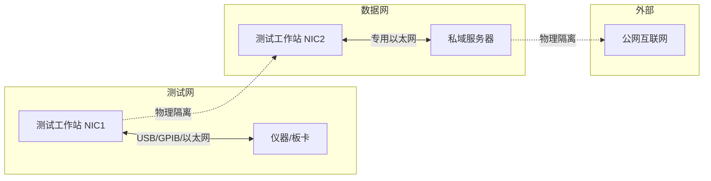
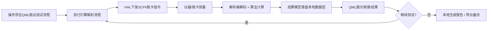

# 《通用自动化测试软件平台》架构说明

> 版本：V2.0（基于单机本地测试 + 私域服务器数据服务场景修订）
> 编制依据：原《设计总纲》（xx方案.pdf）
> 运行形态：**单机本地闭环运行 + 按需与私域服务器交换数据，双网卡物理隔离，与互联网完全隔离**

---

## 目录

1. [引言](#1-引言)
2. [设计目标与约束](#2-设计目标与约束)
3. [总体架构](#3-总体架构)
4. [软件分层详解](#4-软件分层详解)
5. [两翼（硬件支撑系统）](#5-两翼硬件支撑系统)
6. [关键数据流](#6-关键数据流)
7. [双网隔离与安全设计](#7-双网隔离与安全设计)
8. [离线交付与运维](#8-离线交付与运维)
9. [与原《设计总纲》的主要修订说明](#9-与原设计总纲的主要修订说明)

---

## 1. 引言

### 1.1 编写目的

本文档描述"通用自动化测试软件平台"在以下运行场景下的**目标架构**：

- 软件部署于**本地单机**，完整实现测试功能，即使服务器不可达也能独立完成全部测试业务；
- 通讯对象包括**外部仪器、板卡**等测试硬件；
- **测试数据本地留存**为默认原则；
- **必要时**向**私域部署、不连接公网**的远端服务器上报测试结果数据；服务器也可**主动发起询问**，拉取本地数据或向本机下发数据分析结果；
- 硬件上通过**双网卡**将"本地测试网络"与"服务器数据网络"**完全物理隔离**；软件上提供**服务器通信层**，保证两条通道互不串扰。

本文档是后续详细设计、编码与测试的架构基线。

### 1.2 适用范围

- 软件架构师、各层（模块）负责人、测试与交付人员；
- 采购/硬件集成人员（双网卡与网络拓扑部分）；
- 安全与合规评审人员（数据出境与审计部分）。

### 1.3 术语与缩略语

| 术语 | 说明 |
|---|---|
| 测试网（NIC1） | 连接仪器/板卡的本地物理网络（USB/GPIB/以太网） |
| 数据网（NIC2） | 连接私域服务器的独立物理网络（专用以太网） |
| 私域服务器 | 部署于数据网内的私有服务器，不连接公网 |
| HAL | 硬件抽象层（Hardware Abstraction Layer） |
| SCPI | 可编程仪器标准命令（Standard Commands for Programmable Instruments） |
| 测试方法 | 定义"一类指标如何测量"的方法学（算法步骤+判据+参数模板） |
| 测试用例 | 测试方法经参数实例化、含上下限/判据的可执行单元 |
| 测试流程/序列 | 测试用例的有序编排（顺序/分支/循环/依赖） |
| Push | 本机主动向服务器上报数据 |
| Pull / Server-initiated | 服务器主动发起的数据拉取或分析请求 |

### 1.4 参考文档

- 《通用自动化测试软件平台 设计总纲》（原方案，下称"原《设计总纲》"）
- 本架构说明第 9 章为对原《设计总纲》的修订对照。

---

## 2. 设计目标与约束

### 2.1 核心设计目标

1. **本地完整可用**：单机、离线状态下，从"建流程 → 控仪器 → 测数据 → 算指标 → 存数据 → 出报告"全链路闭环，不依赖任何外部服务。
2. **数据本地留存**：测试数据以本地为唯一权威源（Source of Truth），默认不外发。
3. **按需交换**：支持"本机主动上报"与"服务器主动询问/拉取/下发分析"两种模式，且**服务器不可达不影响测试**。
4. **双网隔离**：测试通道与数据通道在硬件、软件、数据三个层面完全隔离，互不串扰。
5. **自主可控**：核心算法 100% 自研，支持国产操作系统（麒麟 V10 / 统信 UOS / openEuler 等）。

### 2.2 硬性约束（运行环境）

| 约束 | 要求 |
|---|---|
| 互联网 | 完全隔离，软件不得出现任何公网域名/公网出口 |
| 服务器 | 私域部署，不连接公网，仅通过数据网与本机互通 |
| 网络 | 双网卡：NIC1=测试网，NIC2=数据网，物理隔离 |
| 测试数据 | 本地留存为原则；上报/被拉取需符合授权与审计策略 |
| 离线交付 | 依赖、构建、授权、升级均须支持离线方式 |

### 2.3 非功能需求

- **可用性**：服务器通信层故障/断线对本机测试功能零影响。
- **性能**：实时频谱显示、流程调度满足测试实时性要求；高频数据路径避免跨语言逐点传输。
- **安全**：数据落盘加密、通道双向认证与加密、数据出境控制、全量审计。
- **可维护性**：分层单向依赖、模块可独立替换与单测。
- **可追溯性**：每次测量、每次数据交换均可追溯（时间、操作者、数据指纹）。

---

## 3. 总体架构

### 3.1 架构总览（六层两翼一私服）

本平台采用"**六层两翼一私服**"架构：

```
┌────────────────────────── 测试工作站（本机软件六层） ──────────────────────────┐
│ ① 表示层        QML + QtQuick 6.10（界面/交互/绘图）                           │
│ ② 胶合层        PySide6.QtQml + Shiboken6（QML ⇄ Python/C++ 桥接）             │
│ ③ 应用与算法层  （内部分子层，见 4.3）                                          │
│ ④ 硬件抽象层    C++ HAL（SCPI/板卡驱动/多品牌兼容）                             │
│ ⑤ 本地数据层    SQLite + 文件存储 + 报告 + 模型库 + 审计日志                    │
│ ⑥ 服务器通信层  数据出口/同步代理（上报 + 应答询问 + 分析回传）                  │
└───────┬──────────────────────────────┬──────────────────────────┘
        │ 测试网 NIC1（物理隔离）         │ 数据网 NIC2（物理隔离）
        ▼                               ▼
   [仪器 / 板卡]                    [私域服务器（不连公网）]
   频谱仪/信号源/功率计/            存储 / AI分析 / 报告 / 查询
   专业硬件
```

**六层**：表示层、胶合层、应用与算法层、硬件抽象层、本地数据层、服务器通信层。
**两翼**：测试硬件翼（仪器/板卡，走测试网）、数据服务翼（私域服务器，走数据网）。
**一私服**：私域部署、不连公网的服务器。

### 3.2 双网物理隔离拓扑



- 测试网与数据网**物理不互通**（不同网卡、不同交换机/网段）；
- 私域服务器**不连接公网**；
- 软件侧对两条通道做同等强度的隔离（见第 7 章）。

### 3.3 设计原则

1. **单向依赖**：上层依赖下层，下层不得反向依赖上层；横向模块只被上层调用。
2. **数据本地优先**：一切测量数据先落本地数据层，外发必须显式触发并经过授权。
3. **通道隔离**：测试流量只走测试网，数据流量只走数据网，代码层面绑定网卡。
4. **故障隔离**：服务器通信层故障不影响测试主链路。
5. **可替换性**：仪器、板卡、算法、解析器均可独立替换而不影响其他层。

---

## 4. 软件分层详解

### 4.1 表示层（QML + QtQuick 6.10）

**职责**：人机交互的唯一入口；测试流程的可视化构建、实时数据展示、结果与报告预览。

**主要模块**：

| 模块 | 功能 |
|---|---|
| 节点图编辑器 | 拖拽式测试流程构建（QtQuick SceneGraph + 自定义 QML 类型） |
| 频谱视图 | 实时频谱显示、标记测量（QML Canvas + C++ 渲染优化） |
| 仪表板 | 功率表、参数监控（QtQuick Controls 2） |
| 控制面板 | 仪器/板卡参数配置（QML + C++ 后端数据绑定） |
| 报告预览 | 测试报告本地生成与展示（QML Text + 模板引擎） |

**意义**：QML 的 GPU 加速与声明式语法适合实时、高交互的可视化；表示层完全本地渲染，不依赖外部服务。国产 OS 上需验证 GPU/OpenGL-ES 环境，并提供**软件渲染兜底**（Qt Quick 软件后端）。

### 4.2 胶合层（PySide6.QtQml + Shiboken6）

**职责**：QML 与 Python/C++ 之间的"翻译官"，是表示层与应用与算法层之间唯一的桥接通道。

**核心能力**：
- QML 引擎初始化：Python 侧创建 `QQmlApplicationEngine` 并加载 `main.qml`；
- 上下文属性暴露：`setContextProperty("testController", controller)` 等；
- 类型注册：`qmlRegisterType(TestController, "RfTest.Control", 1, 0, "TestController")`；
- 信号/槽/属性桥接：`Signal / Property / Slot` 装饰器实现 QML ⇄ Python 双向调用；
- C++ 绑定：Shiboken6 生成 Python ⇄ C++ 绑定，使 Python 可调用自研 C++ 性能模块。

**意义**：在"保留 QML 界面能力"与"保留 Python 算法生态"之间建立必要适配；纯本地组件，离线场景完整保留。桥接对象为本地业务对象（控制器、本地存储、报告生成等），**不含任何云/公网对象**。

### 4.3 应用与算法层

本层内容较多，划分为**两个内层 + 三个横向模块**

#### 4.3.1 内层 A：测试语义层（静态定义）

| 子模块 | 职责 | 典型内容 |
|---|---|---|
| 测试方法库 | 定义"一类指标怎么测"的方法学 | 频谱模板法、功率校准法、EVM 测量法（算法步骤 + 判据 + 参数模板） |
| 测试用例库 | 方法 × 参数实例化 → 可执行用例 | "PA-5G-001 输出功率上限测试"（频率范围、上下限、环境条件） |
| 测试流程/序列 | 用例的有序编排 | 顺序、分支、循环、依赖关系（对应节点图编辑器拖出的流程） |

**意义**：将"方法/用例/流程"三者分离，实现复用（同一方法服务多个用例、同一用例参与多个流程），是测试业务的核心资产。

#### 4.3.2 内层 B：测试执行引擎（运行时）

**职责**：把流程定义解释为实际执行动作，管理运行时资源。

- 流程解释执行：解析流程模型，逐节点调度；
- 并行调度与资源分配：多仪器/多板卡的占用、互斥与并行；
- 状态机与异常恢复：超时、错误、断电恢复、可中断/可继续。

**意义**：运行时关注点与"定义"分离，使流程可编排、可重入、可回放，支撑自动化回归。

#### 4.3.3 横向模块①：算法与信号处理库

**职责**：纯计算、无 IO 的算法集合。

- 测量算法：校准、S 参数、EVM/ACPR、频谱模板判定、信号处理；
- 本地 AI 推理：趋势分析、异常检测（ONNX Runtime 等本地推理引擎，模型随安装包离线分发）。

**意义**：核心算法 100% 自研，是"自主可控"卖点的载体；纯函数式设计便于单元测试与跨用例复用。

#### 4.3.4 横向模块②：解析与编解码库

**职责**：设备↔业务之间的数据"翻译"，包括：

- 仪器协议解析：SCPI ASCII 响应、IEEE-488.2 定长二进制块（definite length block）；
- 板卡私有协议解析：自定义帧、字节序、校验、寄存器/中断/DMA 数据；
- 业务编解码：测试结果序列化、数据压缩（特征点提取）、上报格式打包。

**意义**：每种仪器/板卡对应一个独立解析器，可独立扩展；该库同时被 HAL（设备侧解析）与数据/通信层（业务侧编解码）使用，故设计为横向模块。

#### 4.3.5 横向模块③：结果模型与数据接口

**职责**：统一测量结果的抽象结构与存取接口。

- 结果统一结构：test_id、dut_info、measurements（S参数/功率/EVM）、test_conditions、timestamp 等；
- 数据接口：向本地数据层写入、向通信层提供"可上报数据包"。

**意义**：隔离上层业务与底层存储/通信，任何一层改动不影响其他层。

#### 4.3.6 依赖与接口关系

- 依赖方向严格单向：语义层 → 执行引擎 →（算法库、解析库、结果模型）；
- 下层不得反向依赖上层；横向模块仅被上层调用；
- 各子模块可独立开发、单测、替换，支持多人并行。

### 4.4 硬件抽象层（C++ HAL）

**职责**：屏蔽仪器/板卡差异，向上层提供统一接口。

**核心接口**（示意）：

```cpp
class ITestInstrument {
public:
    virtual bool Initialize(string resourceName) = 0;   // 按资源名打开仪器/板卡
    virtual bool Configure(ParameterMap params) = 0;    // 参数配置
    virtual MeasurementResult Measure() = 0;            // 测量
    virtual bool Read(out double[] data) = 0;           // 数据读取
    virtual void Close() = 0;
};
```

**包含**：仪器驱动接口、SCPI 指令封装、板卡驱动、多品牌兼容中间件。

**意义**：多品牌仪器兼容是本平台核心差异化；HAL 让上层只面向接口编程，换仪器不换业务代码。仪器连接走**测试网 NIC1**（USB/GPIB/本地以太网），不涉及互联网。

### 4.5 本地数据层

**职责**：本机数据的唯一权威源与持久化中心。

**组成**：

| 组件 | 内容 |
|---|---|
| 结构化存储 | SQLite：测量结果、用例/流程定义、配置、元数据 |
| 文件存储 | 原始数据文件（S 参数/频谱大数据）、报告文件 |
| 模型库 | AI 模型文件（随安装包离线分发） |
| 审计日志 | 操作、测量、数据交换全量记录 |
| 导入/导出/备份 | 数据留档、离线移交、恢复 |

**设计要点**：
- 程序退出、断电不丢数据（事务 + WAL）；
- 数据本地留存为默认，外发需显式授权（见第 7 章）；
- 为服务器通信层提供"可上报数据视图"接口，但不开放底层写入权限给通信层。

**意义**：单机离线后，数据是平台唯一的价值沉淀；独立成层保证统一 schema、统一备份、可追溯、可移交。

### 4.6 服务器通信层

**职责**：本机与私域服务器之间唯一的、受控的数据通道（数据出口/同步代理）。

**能力**：

| 能力 | 说明 |
|---|---|
| 主动上报（Push） | 测试完成/定时/手动触发，从本地数据层按授权取数，上报私服 |
| 应答询问（Pull/Server-initiated） | 私服发起"拉取数据/下发分析"请求，本机校验授权后响应 |
| 分析结果回传 | 私服分析结果（趋势/异常报告）落地本地数据层并通知界面展示 |
| 离线队列 | 上报/应答先写磁盘持久化队列，断线积压、恢复补传、幂等去重 |
| 通道绑定 | 所有网络连接显式绑定数据网 NIC2，与测试网 NIC1 物理+逻辑隔离 |

**推荐通信机制**：
- **WebSocket 长连接为主**：实时承载服务端"询问/下发"；
- **断线降级为任务轮询**（定时 GET /tasks），恢复后自动切回长连接；
- **RESTful API** 承载批量数据上报、历史查询、报告下载。

**安全**：双向证书/令牌认证、通道加密、数据出境控制、全量审计（详见第 7 章）。

**故障隔离**：通信层故障/断线时，测试主链路（NIC1 侧）零影响；建议通信层以独立进程或独立线程 + 队列解耦承载。

**配置**：服务器地址、证书、上报策略全部走配置文件，禁止任何公网域名硬编码。

---

## 5. 两翼（硬件支撑系统）

### 5.1 测试硬件翼（仪器/板卡）

**组成**：频谱仪、信号源、功率计、专业硬件、各类测试板卡。

**接入方式**：USB / GPIB / 本地以太网（走测试网 NIC1）。

**地位**：测试硬件翼是"翼"而非"层"——它是外部物理设备，不属于软件栈，但决定了平台能力上限；保留它是"单机本地测试"这一场景成立的物质基础。

### 5.2 数据服务翼（私域服务器）

**组成**：数据存储、AI 分析、报告生成、查询服务（部署于数据网内，不连公网）。

**与本机的关系**：
- 是本地数据的**镜像与增值分析方**，不是权威源（本地为准）；
- 通过服务器通信层与本机双向交互；
- 服务器宕机不影响本机测试功能。

**地位**：替代原方案"公网云"，承担原"云"的存储/AI/报告/查询职责，但完全私有化。

---

## 6. 关键数据流

### 6.1 单机测试闭环（主链路）



全程不出本机，不依赖服务器。

### 6.2 数据上报（Push）

1. 触发：测试完成 / 定时 / 手动；
2. 通信层从本地数据层按**授权范围**取数（脱敏、白名单校验）；
3. 写入**磁盘队列** → 若服务器可达则发送，不可达则积压；
4. 服务器确认后标记已上报（幂等去重）；
5. 全过程写审计日志。

### 6.3 服务端询问与拉取（Pull / Server-initiated）

1. 私服通过长连接（或任务队列）发起"拉取请求"；
2. 本机校验请求者身份与授权范围；
3. 从本地数据层取数，按约定格式回传；
4. 私服可继续下发"分析任务/分析结果"；
5. 分析结果落地本地数据层并通知界面展示。

### 6.4 分析结果回传与展示

- 私服分析结果（趋势、异常报告）→ 通信层 → 本地数据层留存 → 胶合层信号 → QML 展示；
- 本机离线时，分析结果积压于服务器侧，待下次连接补发。

---

## 7. 双网隔离与安全设计

### 7.1 硬件隔离

- 测试网（NIC1）与数据网（NIC2）使用**独立网卡、独立交换机/网段**；
- 物理上不互通；私域服务器不连接公网；
- 部署拓扑见 3.2 节。

### 7.2 软件侧网络隔离

| 措施 | 说明 |
|---|---|
| 套接字绑定 | 通信层所有 socket 显式绑定 NIC2 接口/IP；HAL 仪器 socket 绑定 NIC1 |
| 路由与防火墙 | 为两个网段配置独立路由与防火墙规则，禁止跨网段转发 |
| 进程隔离 | 通信层建议独立进程/线程承载，崩溃不影响测试主进程 |
| 代码约束 | 全代码库禁止公网域名/公网出口；网络访问统一收敛到受控模块 |

### 7.3 数据出境控制与审计

- **默认不出境**：数据只在显式授权下外发；
- **授权策略**：可上报数据集白名单、脱敏规则、导出审批；
- **审计**：记录"谁、何时、发了/取了什么数据、数据指纹（哈希）"；
- **完整性**：上报数据带校验和，保证传输与落库一致。

### 7.4 双向认证与加密

- 本机与私服**双向证书/令牌认证**；
- 通道加密（TLS）；
- 本地数据落盘加密（涉密/等保场景为硬要求）。

---

## 8. 离线交付与运维

### 8.1 离线依赖与构建链（最高优先级工程项）

原方案 `apt install` / `pip install` 在离线环境不可用，须改为：

- **apt 本地镜像** / 离线软件源（麒麟/UOS/openEuler/Ubuntu）；
- **离线 wheel 仓库** 或 vendored 依赖（PySide6 6.10、Shiboken6 等）；
- **Qt 6.10 离线 SDK**；
- 国产 OS 上 PySide6 缺失时的**源码编译工具链**离线打包；
- 版本锁定 + 校验和清单。

### 8.2 离线授权

- 硬件锁 / 离线授权文件（无联网激活）；
- 授权信息本地校验，支持离线续期。

### 8.3 版本升级与回滚

- 无 OTA：离线升级包 + 完整性校验 + 回滚机制；
- 升级期间数据不丢失（本地数据层兼容性迁移）。

### 8.4 日志与故障定位

- 本地日志分级、滚动归档；
- 审计日志与测试日志分离；
- 支持离线导出日志用于远程协助分析（经授权后通过数据网）。

---

## 9. 与原《设计总纲》的主要修订说明

本章说明针对原《设计总纲》（xx方案.pdf）所做的**主要修订**，供评审对照。

### 9.1 修订概述

原方案定位"四层两翼一云"（公网云、云边协同、多端共享），面向**互联网可达**场景；本架构按"**单机本地测试 + 私域服务器数据服务、双网卡物理隔离、与互联网完全隔离**"场景收敛，形成"**六层两翼一私服**"。核心差异：**云→私服、通信层改为受控双向通道、新增本地数据层、新增双网隔离与离线交付设计、应用与算法层子分层**。

### 9.2 保留内容

| 原章节 | 保留情况 |
|---|---|
| 第 2 章 表示层（QML+QtQuick） | 完整保留，仅补充国产 OS 软件渲染兜底 |
| 第 3 章 中间胶合层（PySide6.QtQml） | 完整保留，桥接对象改为本地业务对象 |
| 第 5 章 应用与算法层（C++/Python 混合） | 核心保留，内部按本架构 4.3 节子分层 |
| 第 5.2 章 硬件抽象层（C++ HAL） | 完整保留 |
| 第 6 章 国产 OS 适配 | 保留，网络适配风险重新评估（见 9.4） |
| 数据压缩（特征点提取） | 保留，应用于本地存储与上报带宽优化 |

### 9.3 删除内容

| 原内容 | 删除原因 |
|---|---|
| "四层两翼一云"中的"一云"（公网云端分析服务器） | 私域部署、不连公网，公网云不存在 |
| 1.2 节差异化定位中的"云边协同分析" | 无公网云，改为"本地 AI 分析" |
| "多端共享"能力 | 单机+私服场景下无公网多端，改为"私服查询/报告分发" |
| 服务器通信层中的公网云客户端（硬编码 `wss://api.rftest.cloud`、`https://api.rftest.cloud/v1`） | 公网域名在隔离环境不可用且是安全隐患，改为配置化私服地址 |
| 4.7 节 QML 中"云连接状态指示灯/上传按钮"交互 | 改为"本地存储状态/上报状态/导出"交互 |

### 9.4 修改内容

| 原内容 | 修改为 |
|---|---|
| 第 4 章 服务器通信层（公网云单向上报） | **私域服务器双向通道**：Push + Pull/Server-initiated + 分析回传；绑定数据网 NIC2 |
| 4.1 节参考架构（内网服务器/云化方案） | 明确采用"**内网私有服务器**"形态，服务器不连公网 |
| 4.3 节 `_pending_data` 内存缓冲 | 改为**磁盘持久化队列**（断线积压、恢复补传、幂等去重） |
| 4.5 节服务端 API（/measurements、/analysis/trend、/analysis/anomaly 等） | 保留接口形式，但**部署于私服**；AI 分析同时提供**本地降级**（本地模型/传统算法） |
| 6.2 节网络适配风险 | 新增"**双网卡隔离、数据出境控制**"风险项；WebSocket 兼容性风险降低优先级（测试主链路不依赖它） |
| 7.1 节依赖安装（apt/pip 在线安装） | 改为**离线软件源/vendored 依赖/离线编译链**（见本架构 8.1 节） |
| 架构表述 | "四层两翼一云" → "**六层两翼一私服**" |

### 9.5 新增内容

| 新增项 | 说明 |
|---|---|
| 本地数据层（第五层） | SQLite + 文件存储 + 报告 + 模型库 + 审计；数据本地权威源 |
| 双网卡隔离设计 | 硬件拓扑（NIC1/NIC2）+ 软件侧绑定/路由/防火墙/进程隔离 |
| 数据出境控制与审计 | 授权白名单、脱敏、审计、校验和 |
| 应用与算法层子分层 | 语义层（方法/用例/流程）+ 执行引擎 + 算法库 + 解析编解码库 + 结果模型 |
| 离线交付与运维 | 离线依赖供给、离线授权、离线升级回滚、日志导出 |
| 私域服务器部署说明 | 服务器形态、双向认证、故障不影响本机测试 |

### 9.6 章节级修订对照表

| 原《设计总纲》章节 | 修订动作 | 对应本架构章节 |
|---|---|---|
| 1 概述（项目背景/设计目标/总体架构） | 修改：定位与架构表述更新 | 2、3 |
| 2 表示层详细设计 | 保留（+软件渲染兜底） | 4.1 |
| 3 中间胶合层详细设计 | 保留 | 4.2 |
| 4 服务器通信层详细设计 | 重写：私服双向通道 + 双网绑定 + 离线队列 | 4.6、6.2、6.3、7 |
| 5 后端核心模块（C+++Python 混合） | 修改：内部子分层 | 4.3、4.4 |
| 6 国产 OS 适配 | 修改：新增双网/出境风险 | 7、8 |
| 7 开发环境与构建配置 | 重写：离线依赖与构建链 | 8.1 |

---

*（文档结束）*
